<!-- PROFILE V11: LOFI DEVELOPER JOURNAL -->

  <picture>
    <source media="(prefers-color-scheme: dark)" srcset="./assets/v11/intro-dark.svg" />
    <source media="(prefers-color-scheme: light)" srcset="./assets/v11/intro-light.svg" />
    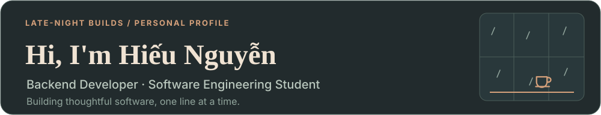
  </picture>

  

  <a href="mailto:hieund1775@gmail.com">Email</a> &nbsp;·&nbsp;
  <a href="https://www.linkedin.com/in/hieund-se">LinkedIn</a> &nbsp;·&nbsp;
  <a href="https://www.facebook.com/nguyen.hieu.196886/">Facebook</a> &nbsp;·&nbsp;
  <a href="https://github.com/hieund1775">GitHub</a>

<!-- WEATHER_START -->

🌤 Ho Chi Minh City · 09/11/2026 · 25°C

<!-- WEATHER_END -->

<!-- ABOUT ME -->

  <picture>
    <source media="(prefers-color-scheme: dark)" srcset="./assets/sections/dark/01-system-identity.svg" />
    <source media="(prefers-color-scheme: light)" srcset="./assets/sections/light/01-system-identity.svg" />
    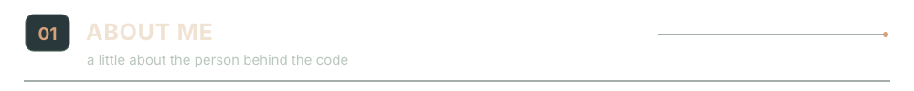
  </picture>

  <picture>
    <source media="(prefers-color-scheme: dark)" srcset="./assets/v11/about-dark.svg" />
    <source media="(prefers-color-scheme: light)" srcset="./assets/v11/about-light.svg" />
    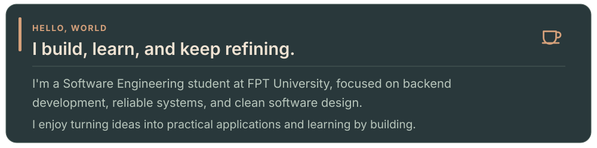
  </picture>

  <picture>
    <source media="(prefers-color-scheme: dark)" srcset="./assets/v11/personal-dark.svg" />
    <source media="(prefers-color-scheme: light)" srcset="./assets/v11/personal-light.svg" />
    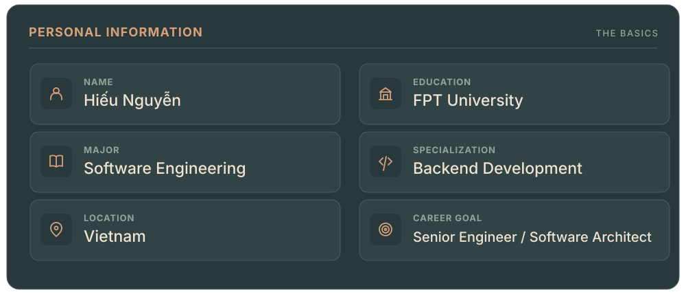
  </picture>

  <picture>
    <source media="(prefers-color-scheme: dark)" srcset="./assets/v11/interests-dark.svg" />
    <source media="(prefers-color-scheme: light)" srcset="./assets/v11/interests-light.svg" />
    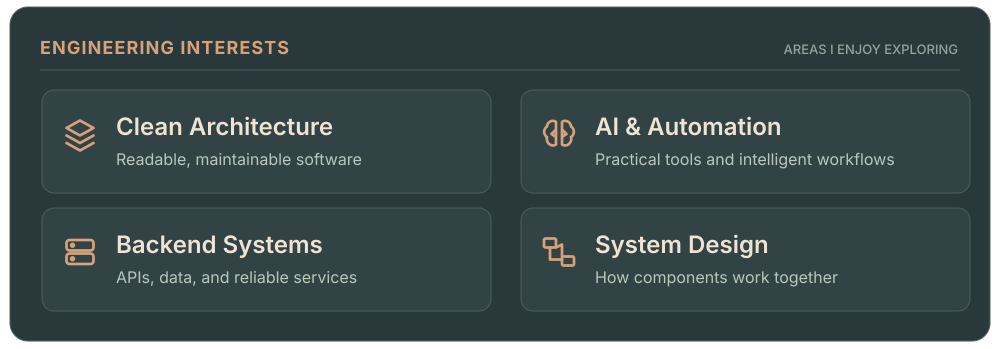
  </picture>

<!-- TECH STACK -->

  <picture>
    <source media="(prefers-color-scheme: dark)" srcset="./assets/sections/dark/02-tech-stack.svg" />
    <source media="(prefers-color-scheme: light)" srcset="./assets/sections/light/02-tech-stack.svg" />
    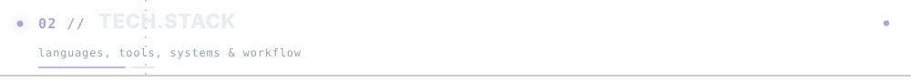
  </picture>

  <picture>
    <source media="(prefers-color-scheme: dark)" srcset="./assets/v11/tech-dark.svg" />
    <source media="(prefers-color-scheme: light)" srcset="./assets/v11/tech-light.svg" />
    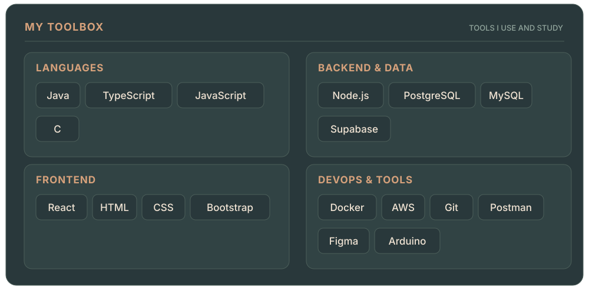
  </picture>

<!-- GITHUB TELEMETRY -->

  <picture>
    <source media="(prefers-color-scheme: dark)" srcset="./assets/sections/dark/03-github-telemetry.svg" />
    <source media="(prefers-color-scheme: light)" srcset="./assets/sections/light/03-github-telemetry.svg" />
    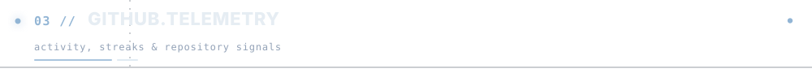
  </picture>

  <picture>
    <source media="(prefers-color-scheme: dark)" srcset="./assets/generated/github-telemetry-dark.svg" />
    <source media="(prefers-color-scheme: light)" srcset="./assets/generated/github-telemetry-light.svg" />
    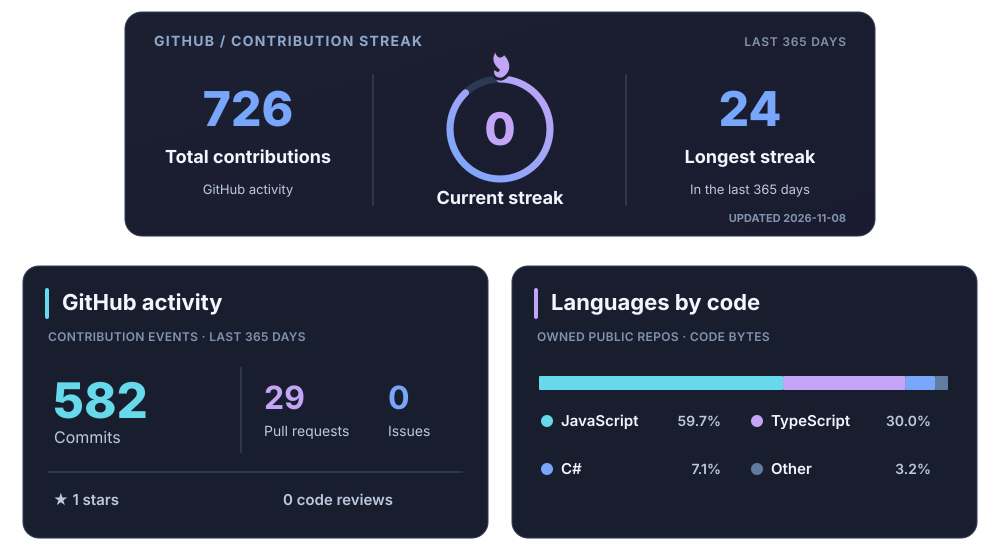
  </picture>

<!-- ACHIEVEMENTS -->

  <picture>
    <source media="(prefers-color-scheme: dark)" srcset="./assets/sections/dark/04-achievements.svg" />
    <source media="(prefers-color-scheme: light)" srcset="./assets/sections/light/04-achievements.svg" />
    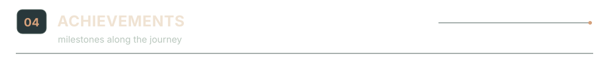
  </picture>

  

<!-- CONTRIBUTIONS -->

  <picture>
    <source media="(prefers-color-scheme: dark)" srcset="./assets/sections/dark/05-contribution-mission.svg" />
    <source media="(prefers-color-scheme: light)" srcset="./assets/sections/light/05-contribution-mission.svg" />
    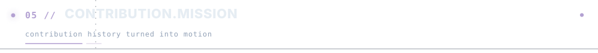
  </picture>

  <picture>
    <source media="(prefers-color-scheme: dark)" srcset="https://github-readme-activity-graph.vercel.app/graph?username=hieund1775&amp;bg_color=222B2D&amp;color=E9D8C3&amp;title_color=E9D8C3&amp;line=C9946E&amp;point=A5C0AA&amp;area_color=4F675C&amp;area=true&amp;hide_border=true&amp;hide_title=true&amp;days=30&amp;radius=12" />
    <source media="(prefers-color-scheme: light)" srcset="https://github-readme-activity-graph.vercel.app/graph?username=hieund1775&amp;bg_color=F4EFE7&amp;color=29383C&amp;title_color=29383C&amp;line=A46C45&amp;point=617D6F&amp;area_color=D1C8BC&amp;area=true&amp;hide_border=true&amp;hide_title=true&amp;days=30&amp;radius=12" />
    
  </picture>

<!-- CONTACT -->

  <picture>
    <source media="(prefers-color-scheme: dark)" srcset="./assets/sections/dark/06-contact.svg" />
    <source media="(prefers-color-scheme: light)" srcset="./assets/sections/light/06-contact.svg" />
    
  </picture>

  <picture>
    <source media="(prefers-color-scheme: dark)" srcset="./assets/v11/contact-dark.svg" />
    <source media="(prefers-color-scheme: light)" srcset="./assets/v11/contact-light.svg" />
    
  </picture>

  <a href="mailto:hieund1775@gmail.com">✉ Email</a> &nbsp;·&nbsp;
  <a href="https://www.linkedin.com/in/hieund-se">LinkedIn</a> &nbsp;·&nbsp;
  <a href="https://www.facebook.com/nguyen.hieu.196886/">Facebook</a> &nbsp;·&nbsp;
  <a href="https://github.com/hieund1775">GitHub</a>

  

Think clearly. Design cleanly. Build reliably.

